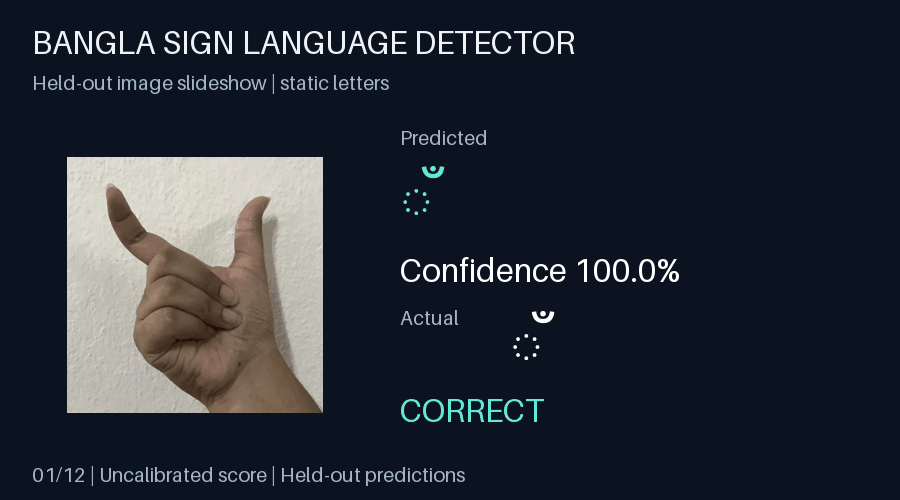
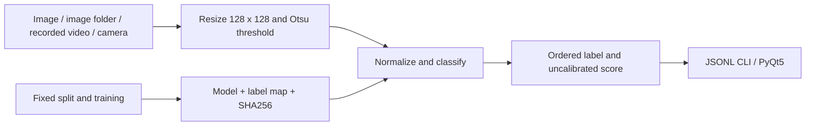
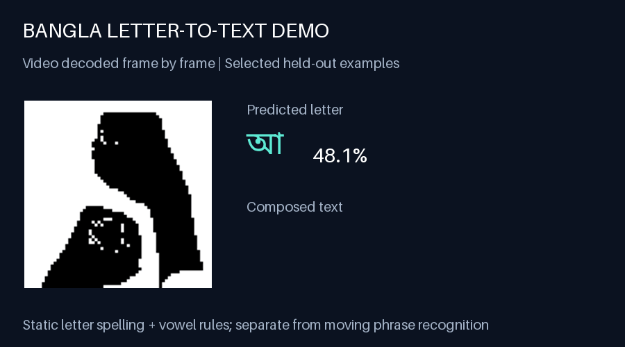
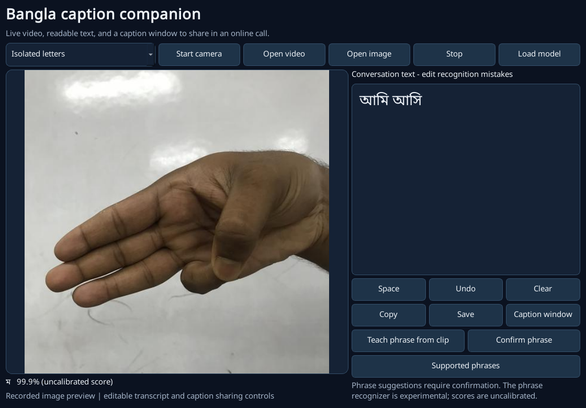

# Bangla Sign Language Detector

I built a Bangla hand-sign recognition system for my B.Sc. thesis, with reproducible evaluation and camera, image and video inputs.



[](https://github.com/iamnajib71/Real-Time-Bangla-Sign-Language-Detector/actions/workflows/ci.yml)  

## At a glance

| | |
|---|---|
| **The problem** | Bangla sign language users lack accessible real-time recognition tools, adding friction when communicating with people who do not sign. This project explores a small static-letter classification task. |
| **What I built** | I built a current TensorFlow/Keras pipeline, compared a CNN with a transfer-learning baseline, and connected the same predictor to image, video, camera and PyQt5 inputs. |
| **Results** | Public KU-BdSL experiment: **99.58% test accuracy on 240 held-out images across 30 grouped classes**. 28 automated tests passed in CPU CI. These are Reproduction results; signer-independent performance is unmeasured. |
| **Skills shown** | Python, OpenCV, TensorFlow/Keras, CNN, computer vision, PyQt5, reproducible experiments, data analysis, pytest, GitHub Actions. |
| **Relevant roles** | Junior ML/AI Engineer, Data Analyst, Junior Data Scientist, Software Engineer. |
| **How it was built** | I designed the workflow, implemented the rebuild and reviewed the measured results; CPU CI checks the shared prediction pipeline. |
| **Try it / evidence** | [Quick start](#quick-start), [results](docs/RESULTS.md), [complete prediction page](docs/ku-mobilenet-results.html), [raw evidence](reports/), [release](https://github.com/iamnajib71/Real-Time-Bangla-Sign-Language-Detector/releases/tag/v2.0.1). |

The animation is a **30-second slideshow of held-out hand images**, with selected correct and incorrect predictions. It is not a natural-signing video or proof of continuous language translation. [Open the full results page](docs/ku-mobilenet-results.html) locally in a browser to inspect every test example.

## What I did, step by step

1. Preserved the thesis repository as `v2022-thesis` and rebuilt the main tree around the current application.
2. Audited the labelled data, avoided mixing alternate versions of the same image, and fixed a seeded train/validation/test partition.
3. Ported the original CNN to `tensorflow.keras` and measured a single 12-epoch re-run.
4. Added a frozen MobileNetV2 comparison on the same split, then a separate experiment using the licensed public KU-BdSL dataset.
5. Reused preprocessing and prediction for the CLI and PyQt5, including recorded-video and folder inputs.
6. Tested Otsu preprocessing, fixture predictions, GUI input and an entire fixture video without a camera.
7. Published prediction-level evidence, failure examples and a revision draft that separates new measurements from historical claims.

## Problems I hit and how I solved them

- The old code used machine-specific paths and removed Keras APIs. I replaced it with an installable package and repository-relative model paths.
- The original predictor compared probabilities with exactly 1 and assumed numeric class ordering. I use argmax and save the actual ordered label map alongside every model.
- The three old image folders represent the same collection. I use one canonical version, audit content hashes and split before augmentation.
- The paper describes methods that do not match the surviving Python implementation. I preserve v1 and state exactly which implementation the new experiment measures.

## Architecture



## Quick start

Use Python 3.12; Python 3.14 is not supported by this pinned environment. CPU inference and file demos require no webcam. From the repository root:

```powershell
py -3.12 -m venv .venv
.venv\Scripts\Activate.ps1
python -m pip install -r requirements-dev.txt
python -m pip install --no-deps -e .
python scripts/download_models.py
python -m bsl predict image.png
python -m bsl predict --images path/to/hand-crops --output predictions.jsonl
python -m bsl webcam --video clip.mp4 --output predictions.jsonl
python -m bsl webcam
python -m bsl gui
python -m pytest -q
```

On Linux/macOS use `python3.12` and `source .venv/bin/activate`. Frame inputs should already contain a centred hand crop. This is a whole-frame classifier; it does not find hands in arbitrary scenes. CLI output is UTF-8 JSONL; use Ctrl+C to stop a camera stream. The PyQt5 app provides image/video selection and a camera preview.

## Results and evidence

**Reproduction results** (not thesis figures):

| Experiment | Dataset | Classes | Train / validation / test | Test accuracy | Macro F1 |
|---|---|---:|---|---:|---:|
| original | Thesis Gray | 36 | 709 / 148 / 148 | 3.38% | 0.0018 |
| mobilenet | Thesis Gray | 36 | 709 / 148 / 148 | 52.70% | 0.5072 |
| ku-mobilenet | KU-BdSL USLD | 30 | 1020 / 240 / 240 | 99.58% | 0.9958 |

The two thesis rows share a split. KU-BdSL is a separate public-data experiment with a different label space. [Evaluation details and caveats](docs/RESULTS.md); [per-class public metrics](reports/ku-mobilenet/per_class.csv); [public confusion matrix](reports/ku-mobilenet/confusion_matrix.png); [all mistakes](docs/ku-mobilenet-results.html).

## Reproduce training and the demo

```powershell
python scripts/download_kubdsl.py
python -m bsl.train --data data/external/ku-bdsl-usld --external --architecture mobilenet --out reports/new-public-run --model models/new-public.keras
python scripts/build_evidence.py --report reports/new-public-run --data data/external/ku-bdsl-usld --name new-public
```

The downloader checks publisher SHA256 values. The trainer refuses to overwrite an already measured output directory. Frozen MobileNetV2 weights download from Keras on the first run. The recorded experiment uses seed 2026, 12 epochs and a frozen backbone; it is not claimed to be the latest research architecture. See [online resources and attribution](docs/ONLINE-RESOURCES.md).

The 2022 `Gray` images can be recovered from `v2022-thesis` into `data/original/Gray` for the historical re-run:

```powershell
python scripts/restore_thesis_data.py
python -m bsl.train --data data/original/Gray --out reports/new-original-run --model models/new-original.keras
python -m bsl.train --data data/original/Gray --architecture mobilenet --split-from reports/new-original-run/split.json --out reports/new-comparison --model models/new-comparison.keras
```

## Camera and text entry

`python -m bsl webcam` opens an annotated live preview with a centred hand guide. Press **Q/Escape** to stop. The PyQt5 app offers camera, video and image selection, plus space, undo, clear and transcript saving.

For isolated-letter text entry with the 36-class model:

```powershell
python scripts/download_models.py --experiment mobilenet
python -m bsl webcam --model models/mobilenet.keras --compose
python -m bsl webcam --video assets/sentence/letter-spelling.avi --model models/mobilenet.keras --compose --min-confidence 0.4 --output spelling.jsonl
```



The spelling video forms **আমি আসি** using selected held-out letter images and explicit pause cards. It is an illustrative software demonstration, not an independent accuracy benchmark. [Frame-by-frame evidence](reports/sentence/evaluation.json).

## Common-phrase motion experiment

The linked Grameenphone and BRAC tutorials contain moving sentence signs. A separate landmark/DTW prototype compares temporal movements and includes an unrecognised state. In the different-signer test it recognised **1/4 supported phrases** and rejected **4/8 unsupported segments**. It is experimental and does not establish public-ready sentence transcription. [Protocol, crop coordinates and results](docs/PHRASES.md).

## Call companion and sentence vocabulary



Run `python -m bsl gui` for the camera/video preview, editable Bengali transcript and separate caption window. Share that window in your call app. Screenshot text is manually entered to illustrate the controls.

The optional temporal model supports ten complete sentences: **6/10 supported sentences correct; 8/10 background clips rejected; 10 accepted captions with 60% precision** on a separate dataset signer ID. This small exploratory test does not establish general-call transcription. Suggestions require confirmation. [Setup, exact vocabulary and full errors](docs/SENTENCES.md) · [Call workflow](docs/CALL-COMPANION.md).

## Video-upload test and scientific figures

The actual **Open video** flow was checked with a supported held-out clip, a false-match clip, and the supplied BRAC greeting. The test records the observed suggestions and confirms that captions require user confirmation. [Upload test, screenshots and errors](docs/VIDEO-UPLOAD-TEST.md) · [Raw evidence](reports/sentences-background/video-upload-test.json).

The manuscript includes a pipeline diagram, unsmoothed validation curves, static and temporal confusion matrices, and correct/incorrect examples. [Training curves](paper/v2/figures/validation-curves.png) · [Sentence confusion matrix](reports/sentences-background/confusion_matrix.png).

For future commercial use, [the scientific validation plan](docs/SCIENTIFIC-ROADMAP.md) sets out Deaf-user involvement, data permissions, independent signer/session tests, novel unsupported inputs, continuous-signing errors and end-to-end latency. These are requirements still to be met, not claimed achievements.

## Run and test on Windows

From the repository folder, run `setup.bat` once to install the pinned dependencies and verified model assets. Then double-click `run-app.bat`. Use **Open video**, select a complete supported signing clip, and choose **Sentence vocabulary (experimental)** for the temporal model. Use **Supported phrases** to check its ten-sentence vocabulary. Suggestions require confirmation; typing and corrections remain available.

Run `python -m bsl doctor --motion` to verify pinned dependencies, model checksums, label order and tracking assets without importing TensorFlow or opening a camera. Run `run-tests.bat` for the camera-free automated suite. The local source-video integration check is `python scripts/test_video_upload.py`; it requires the local source clips described in the test report. Those third-party videos are not bundled with the repository.

## Project structure

```text
src/bsl/        CLI, shared predictor, preprocessing, models, PyQt5, training
scripts/        verified data/model downloads, demos and evidence generation
tests/          preprocessing, real Keras fixture model, GUI, fixture video
assets/         held-out demo images, GIFs, openly licensed Bengali font
reports/        immutable measured splits, hashes, metrics and predictions
docs/           results pages, provenance, release notes, publication handoff
paper/v1/       unchanged 2022 preprint
paper/v2/       Overleaf-compatible revision draft and compiled PDF
models/         ignored local binaries; published as release assets
```

## Citation and research history

This rebuild grew from my 2022 B.Sc. thesis at North South University. The original work is a **non-peer-reviewed ScienceOpen preprint**:

> Hassan, Nazmul (2022). *Bangla Sign Language Gesture Recognition System: Using CNN Model*. ScienceOpen Preprints. DOI: [10.14293/S2199-1006.1.SOR-.PPUF56Q.v1](https://doi.org/10.14293/S2199-1006.1.SOR-.PPUF56Q.v1).

Use [CITATION.cff](CITATION.cff) for software citation. The [v2 manuscript draft](paper/v2/main.pdf) adds reproducible code and reproduced measurements; it has **not** been uploaded or assigned a v2 DOI. Nazmul uploads it as a new version of the same preprint. [Publication profile checklist](docs/PUBLICATIONS.md).

## Honest limits

- Small datasets and constrained hand-crop conditions. Signer identities and sessions cannot be separated in the available folder labels.
- Image-level test scores may benefit from shared signers, backgrounds or similar captures. They do not measure performance on unseen signers.
- The static classifier handles letters/groups. The separate sentence model has a fixed ten-sentence vocabulary; unrestricted signing, grammar and facial-expression understanding remain unvalidated.
- Historical class mappings still need review by a Bangla Sign Language expert. KU-BdSL uses grouped consonant labels.
- Softmax confidence is uncalibrated. No clinical, accessibility effectiveness or production-readiness claim.
- Camera mode includes a hand-placement guide and text controls. CI verifies recorded-frame processing; physical camera compatibility depends on the device and driver.

Code: MIT. Public dataset and thumbnails: CC BY 4.0, credited to the KU-BdSL authors. Fonts: SIL OFL. The historical paper retains its CC BY 4.0 licence; historical data provenance limits are documented separately.

## Built by Nazmul Hassan

[LinkedIn](https://www.linkedin.com/in/iamnajib71/) · [GitHub](https://github.com/iamnajib71) · [ORCID](https://orcid.org/0000-0001-6116-017X)
