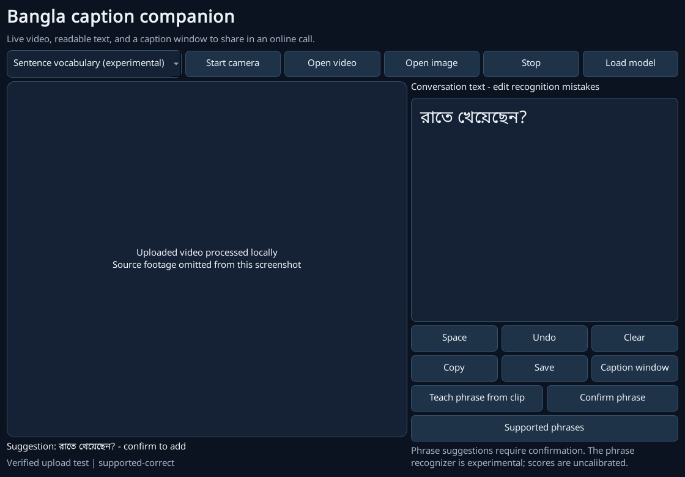
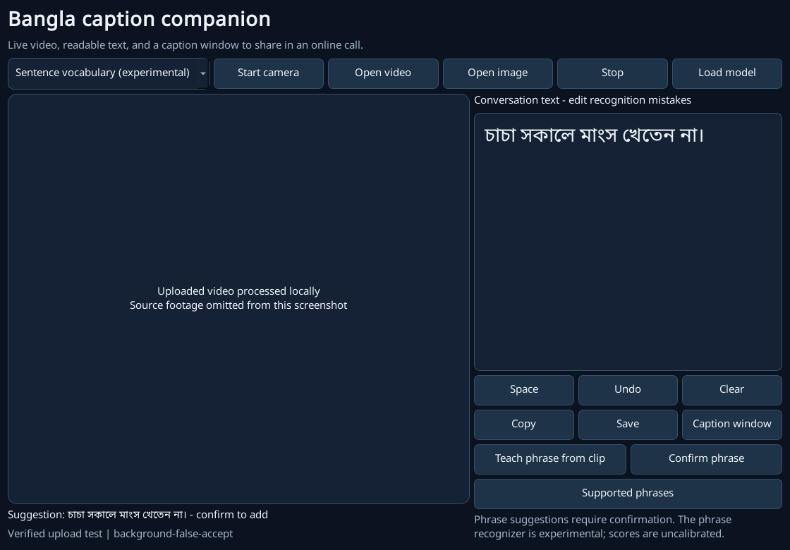
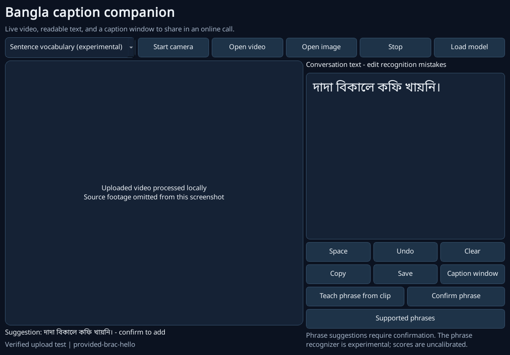

# Video-upload integration test

This test invokes the desktop app's **Open video** handler. The operating-system chooser return is automated; the decoder, source-media clock, landmark tracker, exported GRU, suggestion state and confirmation action are real. It does not upload video to Rylo or another external service.

| Case | Source meaning | Actual suggestion | Decoded frames |
|---|---|---|---:|
| supported-correct | রাতে খেয়েছেন? | রাতে খেয়েছেন? | 262 |
| background-false-accept | মা মাংস খান না। | চাচা সকালে মাংস খেতেন না। | 136 |
| provided-brac-hello | হ্যালো | দাদা বিকালে কফি খায়নি। | 125 |

The first two examples were chosen from already measured test predictions: one supported success and one background false accept. This verifies implementation consistency and exposes an error; it is not a new independent accuracy estimate. The optional third case is the user's supplied BRAC tutorial greeting, 0.8-5.8 seconds, with normalized signer crop (0.30, 0, 0.85, 1) to exclude the printed text. The ten-sentence model does not support this greeting: a safe result is **Unrecognised**, not an invented translation. No thresholds or weights were changed after inspecting these upload outcomes.

The supplied BRAC greeting was falsely mapped to **দাদা বিকালে কফি খায়নি।**, a supported coffee-related sentence, rather than rejected. This is a failed out-of-vocabulary stress case, not successful greeting transcription. No model or threshold was adjusted to make this test look better.

The transcript stayed empty before confirmation in every case. Confirmation appends the suggestion; it does not make a wrong suggestion correct. Raw evidence records both states, source hashes, frame counts and observed labels. Video pixels are deliberately omitted from the public screenshots; source footage remains local because no redistribution licence was established.

Run `python scripts/test_video_upload.py` with the optional motion dependencies, models and local source files installed. The script uses the exact source paths in the saved report. CI instead exercises a redistributable synthetic fixture through the same file-selection handler, and checks media-clock sampling and stale-state reset.

The integration check exposed playback-clock sampling in the old GUI. The fix samples recorded frames at 8 Hz using their media timestamps, resets tracking for each new file, and classifies the final completed buffer. Camera sampling still uses a monotonic live clock. Loss of tracking clears a pending suggestion, preventing a stale caption from being confirmed. This aligns the recorded-file path with the measured CLI preprocessing.

**Failed unsupported-greeting test:**

